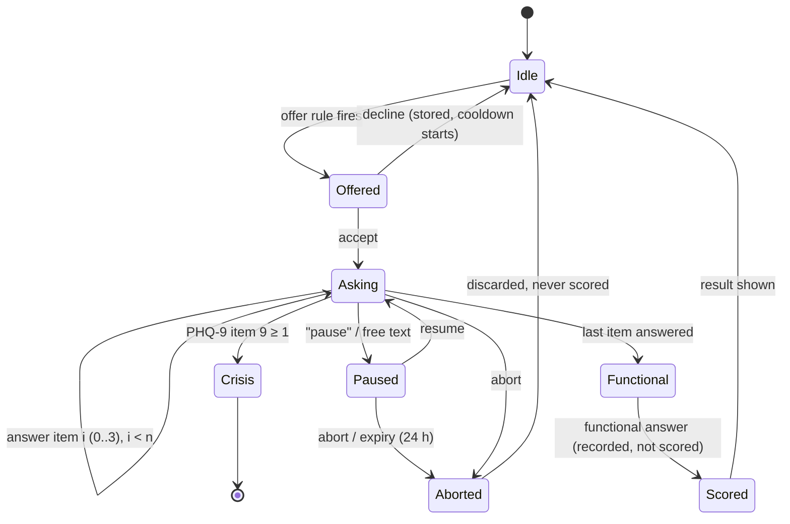

# OASIS — Detailed Design

| Field | Value |
|---|---|
| Status | Draft for approval (Step A) |
| Last updated | 2026-10-07 |
| Depends on | [PRD.md](PRD.md), [architecture.md](architecture.md), [rules.md](rules.md) |

All numeric weights, thresholds, window sizes and cooldowns below are **engineering starting values**, stored in versioned YAML, flagged `needs_clinician_review`, and listed in [clinical_review.md](clinical_review.md). The only clinically fixed numbers are the published PHQ-9 and GAD-7 scoring bands.

---

## 1. Shared types (`oasis.types`)

Frozen dataclasses (or frozen Pydantic models at the API boundary). No user text appears in any type that reaches the trace or logs.

```python
Mode = Literal[
    "crisis",
    "post_crisis",
    "assessment",
    "psychoed",
    "companion",
    "cbt",
    "dbt",
    "mindfulness",
    "grounding",
]


@dataclass(frozen=True)
class SafetyVerdict:
    is_crisis: bool
    tiers: frozenset[
        str
    ]  # {"explicit", "passive", "plan_method", "burden", "internal_error", "item9"}
    pattern_ids: tuple[str, ...]  # e.g. ("explicit.007",)
    ruleset_version: str


@dataclass(frozen=True)
class Signals:  # all floats in [0, 1] unless stated
    valence: float  # [-1, 1], VADER compound baseline
    emotions: Mapping[str, float]  # sadness, anxiety, anger, shame, loneliness
    dysregulation: float
    distortion: float
    distortion_types: frozenset[str]
    overwhelm: float
    acute_overwhelm: bool
    wants_to_talk: float  # "I just want to talk / vent"
    psychoed_cue: float
    screening_cues: Mapping[str, float]  # per PHQ/GAD domain
    explicit_screen_request: bool
    continue_request: bool  # used only in post-crisis mode
    behaviour: BehaviourFeatures
    degraded: frozenset[str]  # detectors that failed this turn


@dataclass(frozen=True)
class Plan:
    mode: Mode
    templated: bool  # True → no LLM
    template_id: str | None
    technique_id: str | None
    snippet_id: str | None
    assessment_step: AssessmentStep | None
    constraints: tuple[str, ...]  # e.g. ("one_question", "no_advice", "socratic")
    style: StyleProfile
    reason_codes: tuple[str, ...]  # e.g. ("router.margin_met", "hysteresis.1_of_2")


@dataclass(frozen=True)
class TurnTrace:  # never contains text
    turn_id: str
    stages: tuple[StageTiming, ...]  # name, start_ms, duration_ms, outcome
    safety: SafetyVerdict
    plan_mode: Mode
    llm_attempts: int
    guard_outcomes: tuple[str, ...]
    fallback_reason: str | None
    degraded: frozenset[str]
```

---

## 2. Safety layer

Implemented in Phase 2 (`src/oasis/safety/`). Pure Python, stdlib plus PyYAML; no LLM, network or database imports (rules S8, enforced by import-linter and an AST test).

### 2.1 Normaliser (`safety/normalize.py`)

`base_form(text)` applies, in order:

1. **Unicode:** `unicodedata.normalize("NFKC", text)` (folds full-width and compatibility forms), then strip invisible characters (`U+200B..U+200D`, `U+2060`, `U+FEFF`, soft hyphen, `U+180E`).
2. **Case:** `str.casefold()`.
3. **Confusables:** a small table maps Cyrillic and Greek look-alike letters to Latin.
4. **Apostrophes:** every apostrophe form (straight, curly, reversed, modifier letter, grave, acute, prime) is removed, so "can't" and "cant" are the same token. Patterns are written without apostrophes.
5. **Stretched letters:** runs of 3 or more identical letters are reduced to 2 (`kiiiill` → `kiill`).
6. **Whitespace:** collapsed to single spaces.

`normalise(text)` returns the distinct variants that are matched: the base form; a **leetspeak** decoding (`0→o, 1→i, 3→e, 4→a, 5→s, 7→t, @→a, $→s, !→i`, only inside tokens that already contain a letter, so "3 kids" is unchanged); an **unspaced** form (runs of 3 or more single letters separated by one space, dot, dash, underscore or star are joined: `k i l l`, `k.i.l.l` → `kill`); and leetspeak plus unspaced. Ordinary text yields one variant, so the extra cost is only paid on unusual input.

**Tolerant patterns.** Instead of hand-writing `ki{1,2}ll`, every pattern is rewritten once at load by `tolerant()`: each literal letter `c` becomes `c+` and an optional letter `c?` becomes `c*`, so `kill` matches `kil`, `kill` and `kiill`. Letters with any other explicit quantifier, escapes and character classes are copied unchanged.

### 2.2 Pattern files (`content/safety/patterns.yaml`, `allowlist.yaml`)

```yaml
version: "2026.10.0"
review_status: needs_clinician_review
patterns:
  - id: explicit.kill_self
    tier: explicit
    pattern: '\b(?:kill|end) (?:my ?self|me)\b'
    examples: ["i want to kill myself"]
```

- **Tiers:** `explicit` (stated intent), `passive` (wish to be dead), `plan_method` (means, timing, preparation; ID prefix `plan.`), `burden` ("better off without me") and `self_harm` (non-suicidal self-injury: "I cut myself", "I want to hurt myself"; added in Phase 2, CR-01). A self-harm disclosure gets the same handoff as the other tiers. `harm_others` (killing or attacking another person, reported speech included; added 2026-10-29, CR-27) gets the same handoff path with its own reply, `HARM_OTHERS_REPLY`, which names the emergency number; when a risk to self is also found, the self reply is shown.
- Patterns are written against the normalised text (lower case, no apostrophes, single spaces).
- **Load-time validation** (`safety/rules.py`) raises `SafetyConfigError`, and the app refuses to start, on: invalid YAML, a missing version, an unknown tier, an ID without its tier prefix, a duplicate ID, a pattern with no example, a pattern that does not compile, named groups or inline flags, or an unbounded nested quantifier (backtracking risk).
- **Startup self-check:** every example must trigger its own rule through the full matcher; every allow-list `positive_example` must match a suppressed rule without the allow-list and be suppressed with it; every `negative_example` must still trigger.

### 2.3 Matcher (`safety/gate.py`)

```text
RuleSet.hits(text) -> {rule_id: tier}:
    for variant in normalise(text):
        idiom_spans = [(entry.suppresses, span) for every allow-list match in variant]
        for rule in rules:
            for match in rule.regex.finditer(variant):
                if no idiom span that may suppress rule.id covers match.span:
                    record rule.id -> rule.tier; go to next rule

check_fail_closed(gate, text):
    try: return gate.check(text)                  # is_crisis = any hit
    except Exception: return Verdict(is_crisis=True, tiers={"internal_error"})
```

- **No negation handling.** "not", "never", "wouldn't" are ignored by design.
- **Allow-list:** each entry is an idiom regex plus the rule IDs it may suppress. It only removes a hit when the idiom span covers the hit span, so "I'm dying to see it, I want to kill myself" still triggers on the second clause.
- **Classifier (rules S7):** none in v1. A future classifier may only add alerts.
- **Latency:** target p99 under 10 ms per message; `tests/performance/test_gate_latency.py` asserts each sample message stays under 10 ms (best of five runs) and the distribution is reported by `scripts/safety_eval.py`. Cost grows with patterns × variants × length (about 1 ms per pattern on 2 000 dense characters on battery); realistic messages measure p99 0.55 ms.

### 2.4 Crisis handoff and post-crisis state

- **Reply:** the fixed text `HANDOFF_REPLY` in `safety/handoff.py`, a compiled-in constant so it works even if content files cannot be read. It points the user to the "Need help now?" card, which the UI opens next to the reply.
- **Help card:** `resources.yaml` is validated at startup (`safety/resources.py`) and rendered into `index.html` on the server (`api/pages.py`) as nested `<details>` elements, region then country. Opening it needs no JavaScript and no network request, so it keeps working if the backend goes down after the page has loaded. Phone numbers are `tel:` links; each crisis line links to its website. All text is HTML-escaped. The card ends with "If your country isn't listed, call your local emergency number."
- **Coverage:** 224 countries and territories across all inhabited regions.
  - **Tier 1 (40):** at least one crisis line verified on the service's own site or a government site, plus the emergency number.
  - **Tier 2 (184):** emergency number(s) from UK FCDO travel advice (gov.uk Content API). 8 entries carry an `emergency_note` instead of a number where FCDO gives none.
  - Every entry stores its `source` URL and `verified_on` date. No unverified number is shipped. Countries whose official sites could not be fetched for verification are Tier 2, with the reason recorded in `docs/reports/phase-02.md`.
- **Country selection** is user-driven (open the region, then the country). Since 2026-10-24 (Smriti) the card also opens the country of the computer's time zone first: when the card opens, `app.js` reads `Intl…resolvedOptions().timeZone` and copies the matching country, already open, above the full list, and folds the list into its dropdown, relabelled "Not right? Choose another country". The list is rendered open as "Choose your country", so with no script or no match it shows as before. Each country element carries its zone names in `data-zones`, from `content/help/time_zones.yaml`, which `scripts/time_zones.py` builds from the IANA database (`zone.tab`, plus older names only when their rules match one country alone; a test checks the file is the script's output). No permission prompt, nothing sent or stored, works with the backend down; no match (e.g. UTC) shows the list as before. Location was considered and not used (rules P6, network location services, a prompt at a crisis moment). Remembering a chosen country stays in Phase 11.
- **Ordering:** a crisis verdict returns the handoff immediately: no storage read, planning, LLM call or guard. The session is added to the engine's in-memory post-crisis set at once.
- **After the response is sent,** `/chat` runs `ChatEngine.record_crisis` as a background task (saved mode only). It persists the `post_crisis` flag, appends an audit entry and appends a history placeholder. Any storage error is logged by exception type only; it cannot affect the reply.
- **Audit entry** (`audit_log`, event `crisis_handoff`): `{tiers, pattern_ids, ruleset_version, source: "text"}`. The message text is **not** stored.
- **History:** the crisis message is never written; a `placeholder` turn reads "A message here was answered with crisis support. Its text was not saved." and the UI shows it as a muted note, not a bot message
- **Post-crisis mode (provisional, CR-05):** every message still goes through safety first. If clear, the planner emits `Plan(mode="post_crisis", templated=True, template_id="post_crisis")`: a short supportive template that points to the help card and explains how to continue. The flag clears only on an explicit wish to continue ("I'd like to keep talking", "can we keep talking", "I'm ready to continue talking", or the UI's "Continue talking" button, which sends "I'd like to keep talking."), matched on `base_form()` text.
- **If storage fails,** the in-memory set is authoritative. If the app restarts while storage is down, the session behaves as normal (documented limitation, CR-05).

---

## 3. Screening trigger

### 3.1 Readiness score
For each turn *t*, compute a per-turn evidence value:

```
e_t = Σ_d  w_d · cue_d(t)            # symptom words mapped to PHQ-9/GAD-7 domains
    + w_v · max(0, −valence_t)        # negative valence only
```

Readiness over a sliding window of the last `W = 6` user turns with linear decay:

```
R_t = Σ_{k=0}^{W-1} (1 − k/W) · e_{t−k}  /  Σ_{k=0}^{W-1} (1 − k/W)
```

### 3.2 Offer rule
Offer the instrument whose domains contributed more (PHQ-9 vs GAD-7; tie → PHQ-9) when:

- `explicit_screen_request` is true (immediate), **or**
- `R ≥ θ_offer` (start: 0.45) for `k = 2` consecutive turns (3 until 2026-10-12),

**and all guards pass:** not crisis / post-crisis; not mid-exercise; not mid-assessment; not declined in the last `D = 10` turns or 24 h; no completed administration of the same instrument in the last **10 days** (14 until 2026-10-12; both instruments still ask about the last two weeks).

The stored offer reason is a reason code plus the numeric score, e.g. `{"reason": "sustained_readiness", "R": 0.52, "turns": 2, "top_domains": ["anhedonia","sleep"]}`.

### 3.2a As built (Phase 3)
- Lexicon, weights and parameters live in `content/assessment/trigger.yaml` (CR-09, CR-10). Each PHQ-9 item 1-8 and GAD-7 item 1-7 has a domain pattern (weight 0.7; uncontrolled worry 0.4); a `duration` domain (weight 0.4) raises evidence without choosing the instrument. Per-turn evidence is capped at 1. PHQ-9 item 9 has no trigger domain: the safety layer handles it.
- The valence term `w_v · max(0, −valence_t)` waits for the Phase 4 signals object (no valence detector yet), so it contributes 0.
- A message counts only if it is not about someone else: one with a third-person subject ("my friend", "she") and no first-person word contributes nothing.
- Naming an instrument is not a request ("I read about the PHQ-9"); an explicit request needs a verb such as take, do or try, or a phrase such as "depression test".
- Guards: an open assessment (offered, in progress or paused), a decline in the last 24 h, or the same instrument completed in the last 10 days. The "last D = 10 turns" decline condition is subsumed by the 24-hour window in practice and is not implemented separately. All guards apply to explicit requests except the decline cooldown: it stops OASIS from raising screening itself, but a user who asks is never refused (decided 2026-10-08).
- A crisis: the planner's post-crisis hold blocks every offer until the user says they want to keep talking. After that, an earlier crisis blocks nothing, offered or asked for (Smriti, 2026-10-12; from 2026-10-09 it blocked unprompted offers). A positive PHQ-9 item 9 still escalates to crisis.
- Readiness uses the design formula with the full-window denominator, so the earliest sustained offer is the third symptomatic turn (W = 6, k = 2, θ = 0.45; the fourth with k = 3). The engine loads up to 20 turns for the trigger.

### 3.3 Evaluation
Labelled sample conversations (`should_offer` per turn) → precision, recall and offer latency (turns from first eligible point) reported in Phase 3.

---

## 4. PHQ-9 / GAD-7 state machine

### 4.1 States



### 4.2 Rules
- Item text and options come verbatim from `content/assessment/phq9.yaml` / `gad7.yaml` (verified against the published source in Phase 3; source citation and verification date stored in the file).
- Answers arrive as structured actions (`{"type": "assessment_answer", "value": 0..3}`), never parsed from free text. Free text during `Asking` moves to `Paused` and is handled as a normal turn (safety still runs first).
- **Item 9:** on value ≥ 1, the engine invokes the crisis handoff immediately (`source: "item9"`); the questionnaire is marked `escalated` and is not scored or shown as a result in that turn.
- **Scoring:** `total = Σ answers` only if all items are present; band from the table below. Incomplete → never scored.

| Instrument | Range | Bands |
|---|---|---|
| PHQ-9 | 0–27 | 0–4 minimal · 5–9 mild · 10–14 moderate · 15–19 moderately severe · 20–27 severe |
| GAD-7 | 0–21 | 0–4 minimal · 5–9 mild · 10–14 moderate · 15–21 severe |

- **Result text:** fixed plain-language text per band (`result_text.yaml`, clinician review), always with the non-diagnostic statement and a suggestion to talk to a professional where the band text says so.

### 4.3 As built (Phase 3)
- **Content:** `content/assessment/phq9.yaml` and `gad7.yaml` hold the stem, the four options, the items and the bands verbatim from the official phqscreeners.com forms (verified 2026-10-08); bands match the official instruction manual. The published **GAD-7 form has no functional-difficulty question**, so only PHQ-9 asks one (rules CL1 over this section's state diagram). The stem is shown once, as its own chat message (API `preface`, stored as a separate assistant turn) just before the first question, and again on resume; not on the card.
- **Code:** `assessment/instruments.py` (load, validate, score), `assessment/flow.py` (state machine, pure functions), `assessment/trigger.py` (offer rule). The planner composes them; the engine persists each step before replying.
- **Actions:** the card sends the pressed button's label as `message` plus a structured `action` (`assessment_consent`, `assessment_answer` with `instrument` and `item`, `assessment_pause`, `assessment_resume`, `assessment_abort`). The label keeps history readable and still passes the safety gate. A click for an item other than the current one changes nothing and shows the current step again.
- **Item 9:** the engine checks `instrument = PHQ9, item = 9, value ≥ 1` on the action **before any storage access**, so a dead database cannot block the handoff. The questionnaire is marked `escalated` and the audit entry gets `source: "item9"` after the response, in the same background task as other crisis audits.
- **Free text:** typing while an offer is open counts as "not now" (`declined_by: "free_text"`); typing mid-questionnaire pauses it and the message is answered normally.
- **Expiry:** a paused questionnaire is aborted 24 h after it **started** (the record has no separate pause time); aborting discards the answers.
- **Storage failure:** if a step cannot be saved, the reply is the fixed `assessment_unavailable` text and no card is shown.
- **Reload:** the card is not restored after a page reload; typing pauses the questionnaire, and the paused card with Resume appears on that turn.

---

## 5. Signals object and detectors

| Signal | Detector | Notes |
|---|---|---|
| `valence` | VADER compound score, with four fixes from demo testing (2026-10-29): "like" as a comparison ("feels like") and "hand" score nothing; a negated bad word ("not to die") and a good word after "over" or "too" are neutral, not positive | Baseline; [-1, 1] |
| `emotions[*]` | Lexicon scorers (`content/lexicons/emotions.yaml`) | Hand-weighted; normalised by token count, clipped to [0, 1] |
| `dysregulation` | Lexicon (urge, rage, can't control, intensity markers) | DBT-leaning cue |
| `distortion`, `distortion_types` | Lexicon/regex per Burns category (all-or-nothing, overgeneralisation, mental filter, disqualifying the positive, mind reading, fortune telling, magnification, emotional reasoning, should statements, labelling, personalisation) | CBT-leaning cue; reused by the guard |
| `overwhelm`, `acute_overwhelm` | Lexicon (panic, can't breathe, too much, falling apart) + intensity markers; acute if score ≥ θ_acute | Mindfulness/grounding cue |
| `wants_to_talk` | Phrase list ("just want to talk", "just need to vent") | Companion cue |
| `psychoed_cue` | Phrase list (stigma, "what's wrong with me", "is it normal") | Psychoeducation |
| `screening_cues[*]` | Domain lexicons mapped to PHQ-9/GAD-7 domains | Screening trigger |
| `behaviour` | See §9 | Tracking |

**Lexicon scorer** (linear, explainable):

```
score(x) = clip( b + Σ_i w_i · count_i(x) / max(1, n_tokens(x)) · scale , 0, 1)
```

Features are term-count rates, so the pre-clip value is a linear model — SHAP values for it are exact (§10). Weights live in YAML with `version` and `review_status`.

### 5a. As built (Phase 4)
- `core/signals.py` (`extract`) runs every lexicon over the safety normaliser's base form (lowercase, apostrophes removed, stretched letters collapsed) and VADER over the raw text. `core/detectors/lexicon.py` is the scorer above; `valence()` in `core/signals.py` wraps VADER.
- Lexicons: `content/lexicons/emotions.yaml` (sadness, anxiety, anger, shame, loneliness), `cues.yaml` (dysregulation, overwhelm, wants_to_talk, opt_out) and `distortions.yaml` (one scorer per Burns category). All `needs_clinician_review` (CR-20); invalid files stop startup.
- `distortion` is the **clipped sum** of the eleven category scores, not the maximum: several distortions in one message add up, and the sum is still linear before the clip. `distortion_types` lists the categories with any match.
- `opt_out` is true when any opt-out phrase matches ("can we stop", "I don't want to do this"); it is read only while an exercise runs.
- `acute_overwhelm` is not a separate signal: the router compares `overwhelm` with `acute_overwhelm_threshold` in its weights file (CR-11).
- `Signals` holds only the fields used so far; `screening_cues` and `continue_request` stay inside the trigger and the planner (Phase 3), and `behaviour` arrives with Phase 8.
- `psychoed_cue` (Phase 5) is true when any phrase of the `psychoed` scorer in `cues.yaml` matches, like `opt_out`.

### 5b. As built (Phase 12: per-sentence scoring)
- The bias evaluation found that rates per word let words about *who* someone is water down *how* they feel: "As a Muslim woman, I'm so angry I can't control it" delayed the DBT offer, and "Everything is too much, I can't breathe. My husband and I live in Leeds." skipped grounding.
- Each scorer is now computed on its **highest-scoring segment** of the message (`Lexicon.segment`, `segments()` in `core/detectors/lexicon.py`): sentences (split at `. ! ? ;`, line breaks and a spaced dash), and a leading "As a/an …," or "At 68," clause on its own. Other commas stay inside the sentence, so a one-sentence message scores exactly as before; no weight or threshold changed. VADER valence and the harsh-label rule still read the whole message.
- The explanation decomposes the scored segment, so its output is the value the router used and stays additive (design §10).
- Known limit: identity stated inside the sentence in other ways ("I'm a Sikh man and I'm so angry…", "Being a single mum, …") still dilutes; the held-out phrasings in `tests/bias/variants.yaml` measure it (docs/reports/bias_eval.md).

---

## 6. Planner precedence

```text
function plan(signals, state, style) -> Plan:
    if state.post_crisis and not signals.continue_request:
        return Plan(mode="post_crisis", templated=True, template_id="post_crisis.check_in")
    if state.assessment.in_progress:
        return assessment.next_step(state.assessment)            # templated
    if psychoed.should_trigger(signals, state):
        return psychoed.plan(signals, style)                      # LLM phrases one vetted item
    if assessment.should_offer(signals, state):
        return assessment.offer_plan(...)                         # templated
    decision = router.route(signals, state.router)
    if decision.mode == "companion":
        return companion.plan(signals, style)
    return therapy.plan(decision, state, style)                   # cbt | dbt | mindfulness | grounding
```

- Exactly one mode per turn.
- `post_crisis` sits above the precedence list given in the architecture because it is the post-crisis policy from the methodology; it is flagged for clinician review.
- Style is attached to every plan but **read only by the prompt builder** (§12).

### 6a. As built (Phase 5)

```text
post-crisis → exercise button → assessment button → open assessment
  → (exercise running: router only)
  → explicit questionnaire request (+ psychoeducation item as a preface, if cued)
  → psychoeducation item → unprompted questionnaire offer → router
```

- An explicit request beats psychoeducation, but a message that is both gets the item first, as its own message, and then the offer (Smriti, 2026-10-11). An unprompted offer waits; the trigger can fire again on a later turn.
- No psychoeducation while an exercise runs (same guard as the questionnaire offer) or under acute overwhelm, which goes to grounding first.
- `psychoed/selector.py` picks the item: the first item in `content/psychoed/items.yaml`, in file order, whose topic cues match and that has not been shown this session; the general item (no cues, listed last) answers the rest. Shown item IDs are kept in `RouterState.psychoed_shown`, so they persist with the router memory and survive the acute override; once every matching item is used, the message goes to the router.
- The plan is mode `psychoed`, constraints `no_diagnosis, use_snippet_only`, with the item text as the snippet (`- script:` line). If the LLM fails the reply is the item text itself. A psychoeducation turn lapses an open exercise offer, as typing over it does.
- Items are checked at startup: provenance fields, `needs_clinician_review`, compilable cues, exactly one general item listed last, and `reading_level` equal to the Flesch-Kincaid grade computed from the text and at most 8.

### 6b. As built (Phase 11: style profile)

- **The planner never sees the style.** `plan_turn(message, state, action)` is unchanged; the engine attaches the user's `StyleProfile` to the plan *after* planning (`replace(plan, style=...)`), so no decision can depend on it. Only `llm/prompt.py` reads `plan.style`. A Hypothesis property test runs generated conversations (crisis, screening, psychoeducation, thinking-trap, anger, overwhelm, continue, hedged and small-talk messages) under all nine styles and requires identical replies, modes, crisis verdicts, questionnaire and exercise cards, plans, explanations and prompts apart from the style line.
- **Framing** (`content/style/framing.yaml`, CR-25): one sentence per non-default value, joined into one `Style:` line placed just before `PLAN:`. The defaults (balanced, neutral) add nothing, so a user who never opens Settings gets the prompt every earlier phase was tested with. Longest line 183 characters (~52 tokens), inside the §13.3 budget. It reaches every generated reply, exercise acknowledgements included; templated replies (crisis, post-crisis, assessment, offers) are fixed text and do not change.
- **Settings** (migration `0007_settings.sql`, one row per user, no row = defaults): `directness`, `formality`, `country`. `StyleProfile` lives in `oasis.types` (the plan carries it), `UserSettings(style, country)` in the repository; there is no `style/profile.py`. The engine reads settings with the rest of the state; if that read fails the turn uses the default style and is marked `storage.down`. Nothing outside `PUT /settings` writes them (source test).
- **Country** (design §6 help card, moved here from Phase 10): chosen from the help card's own countries on the settings page (server-rendered `<select>`), validated against `resources.yaml`. The chat page fetches it once on load; "Need help now?" opens it first as "Your chosen country:", else the time-zone country (CR-24). The card itself still makes no request (S12). The country never reaches the prompt.
- **Suggestion** (FR-CUL-2, `style/suggest.py`): a phrase list of hedges ("maybe", "I guess", "I'm not sure", …), matched on whole words with apostrophes removed. When the current typed message and at least 2 of the last 3 typed messages are hedged, the directness is not already indirect, and the reply is generated (not templated, not a button), `ChatResponse.style_suggestion` is true; the page shows "You can ask OASIS to word things more gently in Settings." once per tab. The profile is never changed for the user.
- **No demographic inference** (PRD L3c): no type or column holds ethnicity, nationality, language, dialect or similar (tests); the country is a help-card choice the user makes, never used for style; the time-zone suggestion stays in the browser.

---

## 7. Therapy router

### 7.1 Scoring
Modes `M = {companion, cbt, dbt, mindfulness}`. Signal vector `x` (from `Signals`, plus one-hot PHQ/GAD bands when available, current-mode and exercise-state indicators).

```
score_m = b_m + Σ_s w_{m,s} · x_s
contribution_{m,s} = w_{m,s} · x_s           # exact; Σ_s contribution + b_m = score_m
```

Start weights (`content/router/weights.yaml`, clinician review): companion has the highest bias (default mode); `distortion → cbt`, `dysregulation → dbt`, `overwhelm → mindfulness`, `wants_to_talk → companion` are the dominant positive weights; moderate+ PHQ band adds to cbt; moderate+ GAD band adds to mindfulness.

### 7.2 Decision with margin and hysteresis

```text
function route(x, rs: RouterState) -> RouteDecision:
    if x.acute_overwhelm:
        return decide("grounding", reason="acute_override")         # immediate
    if rs.in_exercise and not x.opt_out:
        return decide(rs.current, reason="mid_exercise_hold")
    ranked = sort(modes by score desc)
    leader, runner = ranked[0], ranked[1]
    if leader == rs.current:
        rs.challenger, rs.streak = None, 0
        return decide(rs.current, reason="incumbent")
    if score[leader] - score[runner] < MARGIN:                       # start 0.15
        return decide(rs.current, reason="margin_not_met")
    if leader == rs.challenger: rs.streak += 1 else: rs.challenger, rs.streak = leader, 1
    if rs.streak < N:                                                 # start N = 3
        return decide(rs.current, reason=f"hysteresis.{rs.streak}_of_{N}")
    if leader != "companion" and not rs.consented(leader):
        return decide(rs.current, offer=leader, reason="offer_structured_mode")
    return decide(leader, switched=True, reason="switch")
```

- Every `RouteDecision` contains all mode scores and the ranked contributions for every mode.
- Router state (`current`, `challenger`, `streak`, `in_exercise`, consents) persists per session.

### 7.3 As built (Phase 4)
- **Files:** `router/weights.py` (config, feature vector, `score_modes`), `router/router.py` (`route`, `accept`, `decline`, `stop`, state JSON), `router/exercise.py` (scripts, one step per turn), `content/router/weights.yaml`, `content/techniques/*.yaml`. Hysteresis is one rule inside `route`, so it has no module of its own.
- **Features:** `valence_neg = max(0, -valence)`, the five emotions, `dysregulation`, `distortion`, `overwhelm`, `wants_to_talk`, plus `phq_moderate_plus` / `gad_moderate_plus` (1.0 when a moderate-or-worse result was scored inside the 10-day re-administration window).
- **Start values:** margin 0.15, N = 3, acute threshold 0.6; companion bias 0.35 (others 0); dominant weights distortion → cbt 0.9, dysregulation → dbt 0.9, overwhelm → mindfulness 1.2, wants_to_talk → companion 0.8 (CR-11). Ties go to companion.
- **Order inside `route`:** a running exercise holds unless the user opts out (grounding also holds under fresh overwhelm instead of restarting) → acute override (keeps consents, drops any offer) → opt-out clears the exercise → grounding ends with its script (back to companion) → typing over an open offer counts as "not now" and resets the streak → incumbent / margin / hysteresis / consent offer / switch.
- **State:** `RouterState(current, challenger, streak, offered, exercise, step, consented)` stored as JSON in `sessions.router_state`. Malformed JSON or values load as a fresh state (companion), never an error. Saving is best effort: a failure is logged as `storage.down` and the turn still replies.
- **Consent:** entering cbt, dbt or mindfulness asks first ("Would you like to try …?", Yes / Not now). Yes switches, records the consent for the session and starts that mode's exercise; later switches to a consented mode do not ask again and do not restart the exercise. Not now, or typing instead, clears the offer and the streak. Grounding never asks.
- **Exercises:** one script per mode — Thought check (cbt), STOP skill (dbt), Notice the breath (mindfulness), 5-4-3-2-1 senses (grounding) — shown one step per user message (CR-12). Each step is shown word for word. From 2026-10-13 (Smriti; before, the LLM rephrased it and the 4B model invented steps such as "N is for Name what you are feeling") the LLM writes only one sentence responding to the user's last message, without seeing the step; the engine keeps its first sentence and adds the step text after it. The guard rule `ack_only` rejects a question, an "X is for" step or an instruction of its own (`step_text` in `content/guard/checks.yaml`); after two rejections, or if the LLM fails, the step alone is the reply. The first step after "Yes" is shown alone, with no LLM call. The card under the reply always shows the step's fixed text and "Reply in your own words when you're ready for the next step.", because the model can drop the step from its phrasing (manual test, 2026-10-12); the last step has no card. A "Stop exercise" button or a typed opt-out ends it; no screening offer is made mid-exercise. However it ends (last step, button or opt-out), the conversation goes back to companion (from 2026-10-13; before, cbt, dbt and mindfulness stayed until the router moved on, and the model, told to offer the skill, repeated its steps); consent is kept. The prompt's history leaves out earlier "X is for…" step lines (the chat keeps them), because the model copied the pattern into companion replies ("R is for Reconnect…"); the guard rule `no_exercise_step` rejects a made-up "X is for" step in any generated reply.
- **Planner:** post-crisis → open questionnaire → questionnaire offer (skipped mid-exercise) → router. Constraints per mode follow §13.2; every routed plan carries the full `RouteDecision`, which the trace stores (signal names and numbers only).

---

## 8. Hypercompliance guard

### 8.1 Inputs
`draft`, `plan`, `user_signals` (incl. `distortion_types` and the matched claim spans as token sets — not stored).

### 8.2 Checks (each returns `ok` or a reason code)
| Code | Check | Applies to |
|---|---|---|
| `G-AGREE` | Agreement marker (`you're right`, `that's true`, `exactly`, `I agree`, `it makes sense that you are`) within the same sentence as ≥ 60% token overlap with the distorted claim | Distortion turns |
| `G-LABEL` | Restates a global self-label from the user (`you are a failure/worthless/useless…`) | All |
| `G-PRESUP` | Advice that presupposes the distortion (`since nobody likes you, try…`) — advice verb + claim echo | Distortion turns |
| `G-SOCRATIC` | Distortion turn must contain a validation phrase **and** exactly one question | Distortion turns |
| `G-DX` | Diagnosis language (`you have depression`, `you are bipolar`, `sounds like you have …disorder`) | All |
| `G-MED` | Medication advice (drug names list, dose patterns, `stop/start taking`) | All |
| `C-PRAISE` | Over-praise / flattery markers above threshold | Companion |
| `C-ADVICE` | Unprompted advice imperative when plan constraint `no_advice` is set | Companion |
| `C-DEPEND` | Dependency language (`I'm always here for you`, `you don't need anyone else`, `only I understand`) | All |
| `C-ONEQ` | Exactly one question when constraint `one_question` | Companion, Socratic |
| `C-NOQ` | No question when constraint `no_question` (a listening reply: asked to, after 2 question replies in a row, or a 40+ word message; demo testing 2026-10-29). The engine drops question sentences first; all questions gives `listen_fallback` | Companion |
| `G-LEN` | ≤ token cap; not empty | All |

### 8.3 Flow
```text
draft = llm.generate(prompt)
v = guard.check(draft, plan, signals)
if v.ok: return draft
if remaining_budget() >= GUARD_RETRY_MIN and attempts < 2:
    draft2 = llm.generate(prompt.with_constraints(v.reasons))   # names the failed rules
    if guard.check(draft2, ...).ok: return draft2
return socratic_bank.pick(signals.distortion_types, style)       # deterministic by turn hash
```

Exactly one retry; no other LLM calls. The same `guard.check` is used for therapy and companion replies.

### 8.4 As built (Phase 6: companion checks)
- `guard/checks.py` (`check(draft, plan)`) is the engine's default guard; the Phase 4 pass-through `guard/hook.py` is gone. Reason codes are plan rule names, so a retry names the broken rule back in plain words (`llm/prompt.py` `RULES`); the design codes map as C-ONEQ → `one_question`, C-PRAISE → `no_praise`, C-ADVICE → `no_advice`, C-DEPEND → `no_dependency`, plus `validate_first`.
- **Companion replies only** (Smriti, 2026-10-11), and only for the rules the plan carries: `validate_first` (a validating phrase before the question), `one_question` (exactly one "?", ending the reply), `no_praise`, `no_advice`. CBT and DBT replies are not checked for these until Phase 7.
- **Every generated reply:** `no_dependency`. The system prompt also tells the model never to encourage reliance on OASIS instead of other people.
- Phrase lists: `content/companion/checks.yaml` (CR-14), matched on the safety normaliser's base form; invalid files stop startup.
- **Asked-for advice:** an `asks_advice` cue in `content/lexicons/cues.yaml` ("what should I do", "any tips", "how do I deal with") swaps `no_advice` for `offer_ideas` in that turn's companion plan (FR-CMP-2 "unprompted"); companion rule order is `validate_first, no_advice|offer_ideas, one_question, no_praise`, so suggestions come before the closing question.
- Every LLM-phrased companion plan carries the rules: routed turns, the turn after a crisis is cleared, and typing during a questionnaire.
- **Varied openers:** the planner puts the first three words (normalised) of the last 3 companion replies into `Plan.avoid_openers`; the prompt says "do not begin with: ..." and `fresh_opener` fails a draft that still does.
- **Soft and hard rules:** `validate_first`, `one_question` and `fresh_opener` are soft (`SOFT_RULES`): a draft failing only these is retried, then kept rather than replaced (also when there is no time to retry). `no_praise`, `no_advice` and `no_dependency` are hard: two failures give the fallback, `companion_fallback` ("I hear you. What feels most important to talk about right now?") in companion mode and `guard_fallback` elsewhere. Phase 7 replaces `guard_fallback` with the Socratic bank.

### 8.5 As built (Phase 7: hypercompliance guard)
- **Input side (FR-GRD-1):** the Phase 4 distortion lexicon (`content/lexicons/distortions.yaml`, the eleven Burns categories) is the detector; no second detector. `core/signals.py` `claims(message)` returns each clause holding a distortion phrase as a set of content words (function words and pronouns dropped). `planner.with_thinking_trap` puts `distortion_types` and `claims` on every generated plan (not on templated, exercise-step or psychoeducation plans) and adds `validate_first`, `one_question`, `socratic` and `no_agreeing` to its rules. `Plan.claims` comes from user text, so it is never stored or traced; the trace takes named plan fields only.
- **Output side (FR-GRD-2), `guard/checks.py`:** reason codes are rule names, as in Phase 6: G-AGREE → `no_agreeing`, G-LABEL → `no_self_label`, G-PRESUP → `no_presupposing`, G-DX → `no_diagnosis`, G-MED → `no_medication`, G-LEN → `not_empty`, G-SOCRATIC → `validate_first` + `one_question`.
  - A sentence *echoes* a claim when it repeats at least 60% of the claim's content words. `no_agreeing` fails an echoing sentence with an agreement marker ("you're right", "that's true", "I agree", "exactly", a leading "yes", "it makes sense that you are"), or an echoing clause stated as fact: no hedge, reflection, modal or negation, not a question ("it is your fault").
  - On a thinking-trap message, or any message about medication (`medication_topic`; the planner adds `no_agreeing`), "you're right" or "I agree with you" fails `no_agreeing` even without an echo: told to agree, the model wrote "I agree with you that it feels like this is your responsibility" to "It's all my fault" (stress check, 2026-10-13).
  - `no_presupposing`: an echoing sentence opening "since / because / as / given that" with an advice word.
  - `no_self_label`, `no_diagnosis`, `no_medication` and `no_dependency` run on every generated reply; `validate_first` and `one_question` run on companion replies and on any reply to a thinking trap; `no_praise`, `no_advice` and `fresh_opener` stay companion only.
  - `no_diagnosis` and `no_medication` skip a clause in which the reply declines in the form "can't tell / say / know if or whether" ("I cannot tell you if you have depression"); "I can't say for sure you have depression" is not a refusal, and the next clause is checked as usual.
  - `no_self_label` also catches unlisted labels: "you are (such) a/an/the" and up to three words, harsh when they hold a harsh word ("a monster") or a person word after an adjective VADER scores at or below -0.3 ("a horrible person", "a bad friend"). The same detector, in the first person, makes "I'm a horrible person" a labelling thinking trap with a claim (`core/signals.py`).
  - `no_medication` matches every form of starting, stopping or changing medicine ("coming off", "weaning off", "cut down on", "tapering").
  - `no_praise` also runs on an exercise step's acknowledgement, and catches praise of a choice or thought ("That is a brave choice", "What a powerful thought").
  - On an exercise step, a reply of one or two words ("okay") gets the step as written, with no LLM call.
  - The token cap is enforced by `llm_max_tokens`, not checked again; `not_empty` rejects a blank draft.
  - Phrase lists: `content/guard/checks.yaml` (CR-16).
- **Reroute (FR-GRD-3):** unchanged flow (one retry naming the broken rules in plain words, `llm/prompt.py` `RULES`; no other LLM call). On a second hard failure, a reply to a thinking trap, or any CBT or DBT reply, gets a question from `content/guard/socratic_bank.yaml` (`guard/socratic.py`; CR-15): the first trap found alphabetically, entry `len(history) % n`, so the pick is deterministic per turn. Every entry validates first and ends in exactly one question; the loader enforces the question count. Companion turns without a trap keep `companion_fallback`; the `guard_fallback` template is gone.
- **Same guard everywhere (FR-GRD-4):** the engine's one `check` covers companion, CBT, DBT, mindfulness and grounding steps and psychoeducation (tested with a spy).
- **Evaluation:** `scripts/guard_eval.py` scores `tests/data/guard/` (curated sycophantic and benign sets, which tuned the lists, and a held-out set that never did) against the targets agreed with Smriti: at least 90% caught, at most 5% of benign replies blocked.

---

## 9. Sentiment and behaviour tracking

### 9.1 Per-turn features
| Feature | Definition | Status |
|---|---|---|
| `valence` | VADER compound | Citation checked in Phase 8 |
| `emotion_*` | Lexicon scores (§5) | Exploratory unless cited |
| `fp_pronoun_rate` | count(I, me, my, mine, myself) / tokens | Citation checked in Phase 8 |
| `absolutist_rate` | count(absolutist lexicon: always, never, completely, nothing, everything, totally…) / tokens | Citation checked in Phase 8 |
| `msg_length` | tokens in message | Exploratory |
| `reply_latency_s` | server receive time − previous bot reply time within the same session, capped at 600 s; `null` for the first message | Exploratory |
| `hour_of_day` | from `client_ts` local hour (client clock used for local time only) | Exploratory |

Latency uses **server** timestamps (client clocks are untrusted); client time is used only for local hour-of-day.

### 9.2 Aggregation
- **Per session:** mean and variance (Welford) of each feature.
- **Trend:** EWMA over session means, `α = 0.3`.
- **Change flag:** once the user has ≥ `K = 5` prior sessions, flag a session whose mean valence is more than `z = 1.5` baseline SDs from the baseline mean (baseline = all prior sessions). Label: "language-based mood trend, not a clinical measure."

### 9.3 As built (Phase 8)
- **Features** (`tracking/features.py`): computed by the engine at stage 8 for every typed user message, from the message and the `Signals` already extracted. Not for button presses (their label is not the user's words) and never for crisis messages (nothing after the safety gate runs). Stored as numbers only in `turn_signals` (migration `0004`, JSON of `TurnFeatures`; deleted with the user).
  - `fp_pronoun_rate` counts I, me, myself and their contractions, **not** possessive my / mine: Tackman et al. (2019) found the depression link for every first-person singular form except the possessive.
  - `absolutist_rate` uses the 19-word dictionary of Al-Mosaiwi & Johnstone (2018); a word right after a negation or qualifier ("not completely", "almost always") is left out, as the paper subtracts these false positives.
  - `reply_latency_s` runs from OASIS's last stored reply in the session (server time), capped at 600 s; `hour_of_day` is the client's local hour (the browser now sends its local time with its offset).
- **Citations** (`content/tracking/features.yaml`, CR-21): valence, first-person pronouns and absolutist words carry a checked source and a note on what it does not show; the rest are labelled exploratory. The loader rejects a feature with both or neither, and any other label.
- **Aggregation** (`tracking/aggregate.py`): per-session mean and sample variance (`statistics`), EWMA over session mean valence (α = 0.3), and the change flag (K = 5, z = 1.5, sample SD; a baseline with no spread flags nothing). Recomputed from the stored features on each request, so no running state is kept; this replaces the Welford update the design named.
- **Trend view:** the per-feature sources sit in a closed "What it is based on" dropdown (Smriti, 2026-10-24); the label stays always visible. `GET /trends` (label, per-feature sources, sessions with means and variances, EWMA, change flags, this session's valence per turn) and `web/trends.html` / `trends.js`, linked from the chat header. The label is always visible; flagged sessions are described as "noticeably different words … about word choice only".
- **New chat** (demo testing, 2026-10-29): a button starts another conversation of the same person (never automatically); the browser keeps only the new key, so an earlier conversation is not reopened in the chat but appears under "Earlier conversations" in the trend view, one graph each, newest first, and in Export and Delete. An unsaved person is forgotten only when every one of their conversations has been idle for two hours.
- **Known gap:** every browser session is a new pseudonymous user (Smriti, 2026-10-20: build the cross-session parts now, prove them on synthetic timelines), so the cross-session line and the change flag fill in only once returning users exist (Phase 10 / 13).

---

## 10. Explanation format

### 10.1 Method
- **Lexicon scorers (linear, hand-weighted):** SHAP values computed with `shap.LinearExplainer` using a background dataset of feature rates from a synthetic neutral corpus (independent-feature assumption): `φ_i = w_i · (x_i − E[x_i])`, `base = b + Σ w_i E[x_i]`. Values are computed on the **pre-clip** linear output; when clipping changes the output, the explanation records `clipped: true`.
- **scikit-learn linear models:** `LinearExplainer` directly.
- **Router:** exact decomposition `contribution_{m,s}` (§7) — no approximation needed.
- **Black-box parts (none in v1):** LIME with a fixed seed.
- **Additivity check** at build time: `|base + Σφ − output| < 1e-6`, else the explanation is marked `inconsistent` and logged (without text).

### 10.2 Stored explanation (JSON)
```json
{
  "explanation_id": "e_7f3c…",
  "turn_id": "t_91ab…",
  "version": "1",
  "scope_note": "Explains why this response strategy was chosen. It does not explain the exact wording, which is generated by a language model.",
  "safety": {"is_crisis": false, "ruleset_version": "2026.10.0"},
  "plan": {"mode": "cbt", "reason_codes": ["router.switch", "hysteresis.1_of_2"]},
  "router": {
    "chosen": "cbt",
    "scores": {"companion": 0.41, "cbt": 0.62, "dbt": 0.18, "mindfulness": 0.30},
    "top_contributions": [
      {"signal": "distortion", "mode": "cbt", "value": 0.31},
      {"signal": "phq_band_moderate", "mode": "cbt", "value": 0.12}
    ]
  },
  "detectors": [
    {"detector": "distortion", "output": 0.64, "base": 0.05,
     "top_features": [{"feature": "overgeneralisation:always", "phi": 0.22}], "clipped": false}
  ],
  "guard": {"attempts": 1, "outcome": "pass"},
  "plain_language": [
    "Your message used words like \"always\" and \"never\", which often go with all-or-nothing thinking.",
    "So the reply gently asks a question that looks at the thought from another angle (a CBT approach)."
  ],
  "status": "ok"
}
```
Feature names are lexicon keys, never raw user text. `status ∈ {ok, unavailable, inconsistent}`.

### 10.3 As built (Phase 9)
- **SHAP values in closed form, no runtime `shap`** (Smriti, 2026-10-22). Every detector is linear: no scikit-learn model was built, and there is no black-box part in v1, so LIME is not used. For a scorer `f(x) = b + Σ cᵢxᵢ` (`xᵢ` a term's matches per token, `cᵢ = scale·wᵢ`), `explain/shap_values.py` computes `φᵢ = cᵢ(xᵢ − E[xᵢ])` and `base = b + Σ cᵢE[xᵢ]`, which is what `shap.LinearExplainer` returns with an independent masker. `shap` is a dev-only dependency: a test checks every scorer against it (equal to 1e-12). This keeps numpy, scipy, pandas and scikit-learn out of the app.
- **Background:** `content/explain/neutral.yaml`, 30 synthetic everyday messages. A term common in ordinary talk ("always", "never", "everyone") has a non-zero mean, so it explains less than a rare one.
- **Additivity check:** `base + Σφ` is compared with the scorer's own `Lexicon.linear()` (the code the router's `score()` runs), with the matches counted once and shared. A wrong φ or base therefore shows as `inconsistent`. A wrong background mean cannot be seen this way (base and φ shift together); the library comparison covers it.
- **Which detectors:** every scorer in `emotions`, `cues` and `distortions` with a pre-clip output above 0, in file order. None for a button press (its label is not the user's words). The harsh-label rule (§8.1) that can raise `labelling` is one more feature, `rule:harsh_label`, so the sum stays exact; it is checked against the larger-of rule in `signals.py`.
- **Record:** `{version, scope_note, status, plan{mode, reason_codes, templated}, router{chosen, reason, offer, modes[{mode, score, bias, contributions}]}, detectors[{detector, output, base, features[{feature, phi}], clipped}], guard{attempts, outcomes, fallback}, plain_language[]}`; `unavailable` records hold `reason` instead. No IDs or timestamps inside, JSON with sorted keys, so identical input gives identical bytes. The router check (`bias + Σ contributions == score`) holds by construction (§7.1) and is kept as a guard against a future change to `score_modes`.
- **Plain language** (`content/explain/plain_language.yaml`): for a routed reply, the top two positive inputs of the leading mode, the thinking-trap categories (the trap replaces "a thinking trap" in the first bullet), and what the reply does (mode, offer, exercise step, or a hold while hysteresis builds). For a reply the planner chose by precedence (questionnaire, psychoeducation, exercise buttons, leaving post-crisis mode), one bullet per reason code instead; a screening offer is keyed by its stored reason (explicit request or sustained readiness). A pre-written fallback adds one bullet. The user's words are never quoted. The file must cover every router signal, mode and distortion category, or startup stops.
- **Storage:** a nullable `explanation` JSON column on `turns` (migration `0005_explanations.sql`, `json_valid` CHECK) instead of the `explanations` table in §11, written in the same `append_turn` as the reply. It is exported and deleted with the turn; `explanation_id` is the reply's `turn_id`. `GET /history` gives each turn's `explanation_id` (or null) without loading the records.
- **Engine:** stage 8 builds the explanation after generation and the guard, before recording. An exception stores `{"status": "unavailable", "reason": "explain.error"}` and adds `explain.error` to the turn's degraded list; the reply is unchanged. Crisis turns return before stage 8 and have no explanation.
- **Debug view and scope note:** removed from the page (Smriti, 2026-10-24); the panel shows the plain-language bullets only. The raw record is still served by `GET /explanations/{id}` and included in the export. The separate `GET /debug/turns/{turn_id}` page (§12) is not built. A failed fetch says "Couldn't reach OASIS" (or that it could not be loaded, for a server error) and is tried again on the next open; a definite answer is kept.

---

## 11. Data model (SQLite, STRICT)

All IDs are `TEXT` (32-char hex UUIDv4). All timestamps are `TEXT` ISO-8601 UTC (`2026-10-07T12:00:00.000Z`). Every table except `schema_migrations` carries `user_id` with `ON DELETE CASCADE`.

```sql
CREATE TABLE users (
  user_id     TEXT PRIMARY KEY,
  created_at  TEXT NOT NULL
) STRICT;

CREATE TABLE sessions (
  session_id_hash TEXT PRIMARY KEY,            -- SHA-256 of the bearer session ID
  user_id     TEXT NOT NULL REFERENCES users(user_id) ON DELETE CASCADE,
  created_at  TEXT NOT NULL,
  last_seen_at TEXT NOT NULL,
  post_crisis INTEGER NOT NULL DEFAULT 0 CHECK (post_crisis IN (0,1)),
  router_state TEXT NOT NULL DEFAULT '{}'      -- JSON
) STRICT;

CREATE TABLE turns (
  turn_id     TEXT PRIMARY KEY,
  user_id     TEXT NOT NULL REFERENCES users(user_id) ON DELETE CASCADE,
  session_id_hash TEXT NOT NULL REFERENCES sessions(session_id_hash) ON DELETE CASCADE,
  seq         INTEGER NOT NULL,
  role        TEXT NOT NULL CHECK (role IN ('user','assistant','placeholder')),
  content     TEXT NOT NULL,
  mode        TEXT,
  created_at  TEXT NOT NULL,
  trace       TEXT,                            -- JSON TurnTrace, no text
  UNIQUE (session_id_hash, seq)
) STRICT;

CREATE TABLE signals (
  turn_id     TEXT PRIMARY KEY REFERENCES turns(turn_id) ON DELETE CASCADE,
  user_id     TEXT NOT NULL REFERENCES users(user_id) ON DELETE CASCADE,
  features    TEXT NOT NULL,                   -- JSON per §9.1
  created_at  TEXT NOT NULL
) STRICT;

CREATE TABLE assessments (
  assessment_id TEXT PRIMARY KEY,
  user_id     TEXT NOT NULL REFERENCES users(user_id) ON DELETE CASCADE,
  instrument  TEXT NOT NULL CHECK (instrument IN ('PHQ9','GAD7')),
  status      TEXT NOT NULL CHECK (status IN ('offered','declined','in_progress','paused','aborted','escalated','scored')),
  offer_reason TEXT NOT NULL,                  -- JSON reason code + score
  total       INTEGER CHECK (total IS NULL OR total BETWEEN 0 AND 27),
  band        TEXT,
  functional  INTEGER CHECK (functional IS NULL OR functional BETWEEN 0 AND 3),
  created_at  TEXT NOT NULL,
  completed_at TEXT,
  CHECK (status <> 'scored' OR (total IS NOT NULL AND band IS NOT NULL)),
  CHECK (instrument <> 'GAD7' OR total IS NULL OR total <= 21)
) STRICT;

CREATE TABLE assessment_answers (
  assessment_id TEXT NOT NULL REFERENCES assessments(assessment_id) ON DELETE CASCADE,
  user_id     TEXT NOT NULL REFERENCES users(user_id) ON DELETE CASCADE,
  item_index  INTEGER NOT NULL CHECK (item_index BETWEEN 1 AND 9),
  value       INTEGER NOT NULL CHECK (value BETWEEN 0 AND 3),
  answered_at TEXT NOT NULL,
  PRIMARY KEY (assessment_id, item_index)
) STRICT;

CREATE TABLE explanations (
  explanation_id TEXT PRIMARY KEY,
  turn_id     TEXT NOT NULL REFERENCES turns(turn_id) ON DELETE CASCADE,
  user_id     TEXT NOT NULL REFERENCES users(user_id) ON DELETE CASCADE,
  body        TEXT NOT NULL,                   -- JSON per §10.2
  status      TEXT NOT NULL CHECK (status IN ('ok','unavailable','inconsistent')),
  created_at  TEXT NOT NULL
) STRICT;

CREATE TABLE audit_log (
  audit_id    TEXT PRIMARY KEY,
  user_id     TEXT NOT NULL REFERENCES users(user_id) ON DELETE CASCADE,
  event       TEXT NOT NULL CHECK (event IN ('crisis_handoff','consent_given','consent_withdrawn','export','settings_changed')),
  detail      TEXT NOT NULL,                   -- JSON, never message text
  created_at  TEXT NOT NULL
) STRICT;

CREATE TABLE consent (
  user_id     TEXT PRIMARY KEY REFERENCES users(user_id) ON DELETE CASCADE,
  disclosure_version TEXT NOT NULL,
  given_at    TEXT NOT NULL
) STRICT;

CREATE TABLE settings (
  user_id     TEXT PRIMARY KEY REFERENCES users(user_id) ON DELETE CASCADE,
  directness  TEXT NOT NULL DEFAULT 'balanced' CHECK (directness IN ('direct','balanced','indirect')),
  formality   TEXT NOT NULL DEFAULT 'neutral'  CHECK (formality IN ('casual','neutral','formal')),
  country     TEXT,                            -- optional, user-chosen ISO code for crisis resources; validated against resources.yaml
  updated_at  TEXT NOT NULL
) STRICT;

CREATE TABLE schema_migrations (
  version     INTEGER PRIMARY KEY,
  applied_at  TEXT NOT NULL
) STRICT;
```

Tables are introduced by the phase that needs them (`0001_init.sql` in Phase 1 creates `users`, `sessions`, `turns`, `schema_migrations`; later migrations add the rest).

**Connection setup (every connection):** `journal_mode=WAL`, `foreign_keys=ON`, `busy_timeout=2000`, `synchronous=NORMAL`, `secure_delete=ON`.

**Retention:** saved-mode data is kept until the user deletes it, or until `saved_idle_expiry_days` (90) pass without a message in any of their sessions (Phase 13, Smriti 2026-10-26): OASIS then deletes it through the same erasure as the Delete button, at startup and once a day, and logs only the count. This bounds how long a conversation stranded by cleared site data stays on disk. The data notice (version 3) says so. Crisis audit entries are deleted with the account.

### 11.1 Ephemeral in-memory twin
`MemoryRepository` implements the same `Repository` protocol with dicts keyed by `user_id`, guarded by an `asyncio.Lock`. Ephemeral sessions expire after 2 h idle or on process restart. Nothing is written to disk: no SQLite, no temp files, no content in logs. Ephemeral mode is chosen at onboarding and cannot be switched to saved mode mid-session without starting a new session (prevents partial persistence).

### 11.2 Repository protocol (excerpt)
```python
class Repository(Protocol):
    async def create_user(self) -> str: ...
    async def create_session(self, user_id: str, session_id_hash: str) -> None: ...
    async def append_turn(self, user_id: str, turn: TurnRecord) -> None: ...
    async def recent_turns(
        self, user_id: str, session_id_hash: str, limit: int
    ) -> list[TurnRecord]: ...
    async def load_state(self, user_id: str, session_id_hash: str) -> ConversationState: ...
    async def save_explanation(self, user_id: str, e: ExplanationRecord) -> None: ...
    async def get_explanation(
        self, user_id: str, explanation_id: str
    ) -> ExplanationRecord | None: ...
    async def export_user(self, user_id: str) -> UserExport: ...
    async def delete_user(self, user_id: str) -> None: ...
```
SQLite calls run in a thread (`asyncio.to_thread`) with one writer connection serialised by a lock.

---

### 11.3 As built (Phase 10)
- **Saved or unsaved per session:** `POST /session {"ephemeral": bool}` (no body: saved). `storage/split.py` sends every call to the store holding that session or user, so an unsaved session never reaches SQLite, not even to read, and keeps working when SQLite is down. The in-memory store has no lock: every method body runs without awaiting, so it is atomic on the one event loop. An unsaved user is forgotten after `ephemeral_idle_timeout_s` (2 h) without a request, checked on every routed request of any session, and on restart.
- **Consent gate in the engine,** after the safety gate and the state load: a session that has not accepted the current notice version raises `ConsentRequired` → `403 consent_required`; a crisis is answered first. Accepted sessions are remembered in memory (`_consented`), so a storage outage does not lock them out; an unknown one is refused. `POST /consent` must name the version shown (`422 invalid_consent` otherwise), writes the `consent` table (migration `0006`) and a `consent_given` audit entry. `GET /session` returns `{ephemeral, consented, disclosure_version}` instead of `consent_required` on `POST /session`. Crisis bookkeeping (audit, post-crisis flag, placeholder) still runs for a session that has not consented (Smriti, 2026-10-24); the UI cannot send a message before consent.
- **Export** (`GET /export`, attachment `oasis-export.json`): `{format: "oasis-export/1", exported_at, ephemeral, tables}`. SQLite exports every table with a `user_id` column, found from the schema, so later tables are included without code changes; the in-memory store returns the same tables and columns (contract test). No `export` audit event is written: the export itself is the record, and audit rows go with the account.
- **Delete** (`DELETE /account {"confirm": "DELETE"}`): one `DELETE FROM users` cascades; `secure_delete` zeroes freed pages; `wal_checkpoint(TRUNCATE)` copies them into the main file and empties the WAL. A checkpoint blocked by another program's open read does not raise but reports busy, leaving the old bytes on disk; the delete then answers `503 erasure_pending` (rows gone, overwrite pending), and the store retries the checkpoint without waiting after every later call and at startup until it succeeds.
- **Session key in the browser** (rules F5, 2026-10-24): `localStorage` for a saved session (reopened in a new tab or after a restart), `sessionStorage` for an unsaved one (ends with its tab); every page reads both. Notice version 2 says anyone using this browser can open a saved conversation. A known session whose consent is for an older notice gets a single "Accept and continue" button that re-consents it, instead of the two start buttons that would create a new session.
- **Notice** (`content/privacy/disclosure.yaml`, CR-23): rendered into `index.html` on the server; the first two sections are shown, the rest under a native "Read more" dropdown, and the agreement line stays above the two buttons ("Save on this computer" / "Start without saving"), which are the consent. `settings.html` / `settings.js` show the mode, Export and a two-step Delete; the header links to it with a gear icon.
- **Departures:** the notice is YAML rendered on the server, not `disclosure.md` or a separate `onboarding.html`; no `routes_privacy.py`, `storage/export.py` or `storage/delete.py` (one route each in `routes.py`, one method per backend); migration `0006_consent.sql` (0004 and 0005 were taken); no separate withdraw-consent control (Delete removes the consent with everything else); the chosen-country setting moved to Phase 11 and a time-zone suggestion was added instead (§6).

## 12. API contracts

All endpoints: JSON; `X-OASIS-Session: <token>` header (except `POST /session` and `GET /health`); security headers; `Cache-Control: no-store`. Request bodies ≤ 16 KB.

**Error shape (all non-2xx):**
```json
{"error": {"code": "consent_required", "message": "Please review and accept the data notice first."}}
```

| Method & path | Request | Response 2xx | Errors |
|---|---|---|---|
| `GET /health` | — | `{"status":"ok","llm":"up\|down\|unknown","storage":"up\|down","version":"…"}` | — |
| `POST /session` | `{"ephemeral": bool}` | `201 {"session_id": "<256-bit token>", "ephemeral": bool, "consent_required": bool}` | 422 |
| `POST /session/new` | — | `201 {"session_id": "<new token>", "ephemeral": bool}`: New chat (demo testing, 2026-10-29), another conversation of the same user in the same store, with their consent and settings | 401, 503 `busy` |
| `POST /consent` | `{"disclosure_version": "1"}` | `204` | 401, 422 |
| `POST /chat` | `{"message": str (1–2000 chars) \| null, "client_ts": ISO-8601, "action": Action \| null}` | `200 ChatResponse` | 401 `invalid_session`, 403 `consent_required` (non-crisis only, §3.3 of architecture), 422 `invalid_turn` |
| `GET /history?limit=50&before=<turn_id>` | — | `200 {"turns": [{"turn_id","role","content","mode","created_at"}], "next": str\|null, "assessment": card\|null}`; `assessment` is the open questionnaire's current card, so a reload restores its buttons | 401 |
| `GET /explanations/{explanation_id}` | — | `200 Explanation (§10.2)` | 401, 404 |
| `GET /trends` | — | `200 {"label": "language-based mood trend, not a clinical measure", "sessions": [... each with "valence" turn by turn and "is_current"], "ewma": [...], "change_flags": [...]}` | 401 |
| `GET /settings` / `PUT /settings` | `{"directness","formality","country"}` (`country`: ISO code on the help card, or null) | `200 Settings` | 401, 403 `consent_required` (PUT), 422, 503 |
| `GET /export` | — | `200 UserExport` (all tables for the user, JSON, `Content-Disposition: attachment`) | 401 |
| `DELETE /account` | `{"confirm": "DELETE"}` | `204` | 401, 422 |
| `GET /debug/turns/{turn_id}` | — | `200 {"trace": TurnTrace, "plan": Plan, "explanation": …}` — own user only; disabled unless `OASIS_DEBUG_VIEW=1` | 401, 404 |

**Action** (structured, from buttons):
```json
{"type": "assessment_consent", "accept": true}
{"type": "assessment_answer", "value": 2}
{"type": "assessment_pause"} | {"type": "assessment_abort"}
{"type": "mode_consent", "mode": "cbt", "accept": true}
{"type": "exercise_opt_out"}
{"type": "continue_after_crisis"}
```

**ChatResponse:**
```json
{
  "turn_id": "t_…",
  "reply": "…",
  "mode": "companion",
  "templated": false,
  "explanation_id": "e_…",
  "assessment": null,
  "crisis": null,
  "persisted": true,
  "degraded": [],
  "style_suggestion": false
}
```
- `assessment` (when in an assessment): `{"instrument","item_index","item_count","item_text","options":[{"value":0,"label":"…"}…],"result":{"total","band","text"}|null}`.
- `crisis` (on handoff): `{"resources":[{"name","contact","hours"}], "message": "…"}`; `explanation_id` is `null` on crisis turns.
- On crisis turns the HTTP status is always `200`, even for unconsented or unknown sessions.

---

## 13. Prompt design

### 13.1 System prompt template (abridged; full text in `content/prompts/system.yaml`)
```
You are OASIS, a supportive listening companion. You are not a therapist or a doctor.
Never diagnose. Never give medication advice. Never claim to be human.
Write {max_sentences} sentences or fewer, plain words, no lists, no emojis.
Follow the PLAN exactly. Do not change its approach.
{style_framing}
PLAN:
- mode: {mode}
- goal: {goal_text}
- must: {constraints_as_text}
{snippet_block}
```
History is passed as alternating chat messages (last `H` turns), followed by the user's message.

### 13.2 Plan → prompt mapping
| Mode | Goal text (example) | Constraints | Snippet |
|---|---|---|---|
| companion | "Respond to what they said, then ask one gentle open question." | one_question, no_advice, no_praise | none |
| cbt | "Acknowledge the feeling. Invite them to examine the thought with one Socratic question." | validate_first, one_question, socratic | one CBT technique snippet |
| dbt | "Acknowledge the intensity. Offer the named skill briefly and ask if they'd like to try it." | validate_first, offer_not_instruct | one DBT skill snippet |
| mindfulness / grounding | "Guide one short, low-risk grounding step from the script." | follow_script, one_step | one script step |
| psychoed | "Explain the concept in the snippet in two or three plain sentences, without diagnosing." | no_diagnosis, use_snippet_only | one psychoeducation item |
| assessment / crisis / post_crisis | — templated, no prompt — | | |

### 13.3 Token budget (context 4096; target prompt ≤ ~1 500 tokens for CPU first-token time)
| Part | Budget |
|---|---|
| System + plan + style | ≤ 450 |
| Snippet | ≤ 200 |
| History (most recent first, truncated at turn boundary) | ≤ 600 |
| User message (truncated with notice if longer) | ≤ 300 |
| Reply (`max_tokens`) | 160 |

Token counts use the server's `/tokenize` endpoint when available, else a conservative chars/3.5 estimate.

### 13.4 Sampling (starting values; re-verify against the current model card)
Non-thinking mode for Qwen3.5: `temperature 0.7, top_p 0.8, top_k 20, min_p 0.0`; thinking disabled via the chat-template argument (`chat_template_kwargs: {"enable_thinking": false}`) and `llama-server --jinja`. Output post-processing strips `<think>…</think>` and any unterminated `<think>` tail; output that is empty after stripping counts as an LLM failure. The bake-off records the final settings.

---

## 14. Content library format

Every file has a header and every item has provenance:

```yaml
schema: oasis.content/v1
kind: socratic_question_bank        # one of the kinds below
version: "2026.10.0"
review_status: needs_clinician_review   # draft | needs_clinician_review | clinician_reviewed
items:
  - id: soc.overgeneralisation.001
    text: "What's one time, even a small one, when that didn't turn out the way you expected?"
    applies_to: [overgeneralisation, all_or_nothing]
    source: "Adapted from standard CBT Socratic questioning; team-authored"
    version: "1"
    review_status: needs_clinician_review
```

| Kind | Item fields (beyond `id, source, version, review_status`) |
|---|---|
| `crisis_patterns` | `tier`, `pattern`, `examples[]` |
| `allowlist` | `pattern`, `suppresses[]`, `positive_example`, `negative_example` |
| `crisis_resources` | `name`, `contact`, `hours`, `region`, `verified_on`, `source_url` |
| `lexicon` | `term` or `pattern`, `weight`, `category` |
| `assessment_instrument` | `instrument`, `item_index`, `text`, `options[]{value,label}`, plus file-level `citation`, `verified_on` |
| `technique_script` | `mode`, `title`, `steps[]`, `risk_level: low`, `contraindications[]` |
| `psychoed_item` | `topic`, `text`, `reading_level`, `cues[]` |
| `socratic_question_bank` | `text`, `applies_to[]` |
| `template` | `template_id`, `text`, `variants[]` |

All files are validated against Pydantic schemas at startup; invalid content refuses startup.

---

## 15. UI/UX design

### 15.1 Screens
1. **Onboarding** — what OASIS is and is not (subclinical, not diagnostic, not for emergencies); data-use disclosure; choice of saved vs ephemeral; consent button. "Need help now?" visible here too.
2. **Chat** — message list, input, send; persistent footer "Support tool, not a diagnosis or emergency service"; "Need help now?" button top-right.
3. **Assessment card** — inline card: instrument name, "Question 3 of 9", item text, four large 0–3 buttons with labels, Pause and Stop links.
4. **Score explanation** — total, band in words, plain-language meaning, non-diagnostic statement, "talk to a professional" text when the band text says so.
5. **"Why this reply" panel** — expandable under each bot message; plain-language bullets only. The scope note (§10.2) and the raw record stay in the stored record, not the page (2026-10-24). Since 2026-10-29 (demo testing) the panels moved to their own page, `why.html` ("Why replies" in the header): every reply of the conversation, newest first, each a closed panel with the start of the reply as its summary; a crisis reply shows only "This was crisis support. Its details are not kept."
6. **Mood-trend view** — simple line of session means with the non-clinical label always visible.
7. **Settings** — style profile (two segmented controls with examples), the help card's country, ephemeral status, Export, Delete (two-step confirm).
8. **Crisis card** — replaces the input area focus: calm heading, resources as large tappable links (`tel:`), "Continue talking" button.
9. **Debug view** — trace, plan, scores, contributions (own data only).

### 15.2 Visual style
Glassmorphism in soft blue, light theme only (dark theme deferred). A blue gradient with three glossy CSS orbs (specular glint, inner shading, the top one softly blurred for depth) and dot patches sits behind one frosted "device" panel (white 40%→30%, 28 px radius, `backdrop-filter: blur(18px)`, 1 px white border, soft blue shadow). Bot messages are translucent blue tiles (`rgba(157,189,245,0.55)`), user messages solid white tiles; the composer is a clear glass bar (white 30%). The crisis help card uses the same glass (white 60%→50%), blue region tiles, white country tiles and darker `#1E4AA8` links with one raised, glowing Send button. Wordmark: "OASIS" in 800 weight, wide tracking, navy `#1C2A3D` → `#1E3F8F` gradient text. Pure CSS, no images. Orbs stay light (darkest `#7399EA`) so any text over them keeps AA.

| Token | Value |
|---|---|
| background | gradient `#C4D9FF` → `#A9C5F8` → `#D2E2FF` |
| `--glass` (help button) | `rgba(255,255,255,0.55)` |
| `--glass-strong` (user bubble) | `rgba(255,255,255,0.9)` |
| `--text` | `#1C2A3D` |
| `--muted` | `#36435A` |
| `--accent` (safety/info) | `#2A5CC0` |
| `--cta` (Send) | gradient `#3A6FD8` → `#2A55C4`, white text |
| `--focus` | `#1A56C4` outline 3 px |

- Typography: Nunito (rounded, SIL OFL), self-hosted at `web/fonts/nunito-latin.woff2` (variable 400–800, Latin subset) with the system stack as fallback; 17 px base, line-height 1.55, max line length ~65 ch.
- Spacing scale: 4, 8, 12, 16, 24, 32 px. Rounded 12 px corners. No animation beyond 150 ms fades; none when `prefers-reduced-motion`.
- All text/background pairs meet WCAG 2.2 AA (checked by a script in Phase 13).

### 15.3 Tone of voice
Warm, plain, brief, non-judgemental; second person; no exclamation marks, no emojis, no clinical jargon, no false promises ("everything will be fine"), no claims of being human or of feelings. Templates follow the same rules.

### 15.4 States
- **Empty:** a short greeting and one example of what the user can say.
- **Loading:** "OASIS is thinking…" with `aria-busy`; input stays editable; after 8 s, "Still working — this can take a few seconds on this computer."
- **Error / offline:** "I couldn't reach the server. Your message wasn't sent." + Retry; the help button still works.
- **Busy:** templated reply "I'm handling a lot right now — could you give me a moment and send that again?"
- **Conversation layout (demo testing, 2026-10-29):** the chat panel fills the window and only the conversation (or the data notice) scrolls, so the composer stays on screen. New messages follow a reader at the bottom; scrolled up, they get a "New message ↓" button instead, and their own message always returns them to the bottom.
- **Typing:** three dots while the reply is generated, then the reply types out word by word (at most 2 s in all). It is already checked in full on the server, so this only reveals it. The note appears once it is done, and `aria-busy` stays on until then, so a screen reader hears the reply once. Crisis and post-crisis replies, and reduced motion, show the reply at once.

### 15.5 Keyboard and screen readers
Enter sends, Shift+Enter newline; Tab order: help button → messages → input → send; assessment buttons are a `radiogroup` with arrow-key navigation; new messages announced via `aria-live="polite"`, crisis card via `role="alert"`; focus moves to the crisis card heading on handoff.

---

## 16. Error handling matrix

| Failure | Detection | Behaviour | User-facing message | Trace code |
|---|---|---|---|---|
| Safety internal error | exception in gate | Treat as crisis (fail closed) | Crisis card | `safety.internal_error` |
| LLM down | connect error < 1 s | Templated reply for plan mode | Normal-sounding templated reply | `llm.down` |
| LLM slow | read timeout / deadline | Templated reply | Templated reply | `llm.timeout` |
| LLM empty / think-only | empty after stripping | Templated reply | Templated reply | `llm.empty` |
| LLM queue full | limiter | Immediate busy template | "I'm handling a lot right now…" | `llm.busy` |
| Guard rejects twice | guard verdicts | Socratic fallback | Vetted Socratic question | `guard.fallback` |
| Guard retry skipped | budget < min | Socratic fallback | Vetted Socratic question | `guard.no_budget` |
| DB locked | busy timeout | Continue stateless; recorder retries once | Reply + small "may not be saved" note | `storage.busy` |
| DB unavailable | `StorageUnavailable` | Continue stateless; skip recording | Reply + "may not be saved" note | `storage.down` |
| Explainability error | exception in builder | Store/return `unavailable` | Panel: "Explanation unavailable for this reply." | `explain.error` |
| Planner/detector error | exception | Companion templated plan; detector neutral | Templated reply | `planner.error` / `detector.<name>` |
| Request deadline exceeded | engine deadline | Templated reply | Templated reply | `request.deadline` |
| Invalid content at startup | schema validation | Refuse to start | — (operator log) | — |
| Frontend cannot reach server | fetch error | Offline state; help card still works | "I couldn't reach the server…" | — |

### 16.1 As built (Phase 13: fault-injection matrix)

Every row is a test over HTTP in `tests/fault_injection/test_matrix.py` (plus `test_degradation.py`), asserting the reply, the request timeout and the trace code. Model failures use the real `LlamaServerClient` against a local stub server, so its own timeouts and parsing are exercised: no listener, a stall, a stream of single bytes (each read succeeds, so only the generation deadline ends it), empty content, a think-only reply, HTTP 500, malformed JSON and no choices. Departures:
- **LLM down** includes a connect *timeout*: on Windows a refused connection is retried for about two seconds, so the 1 s connect timeout fires before the refusal. Both are `llm.down`.
- **Detector error** has no separate code: signals are computed inside the planner, so a detector bug is `planner.error` (companion template). Detectors are pure lexicon scorers validated at startup; per-detector isolation would add code for a failure with no known cause.
- **Crisis bookkeeping** after the handoff (audit, post-crisis flag, placeholder) is bounded by the request timeout, so storage that never answers cannot hold the task.
- Combined rows: model stalled with the database locked; model stalled with storage dead (crisis handed off in under a second, an ordinary message refused at once).
